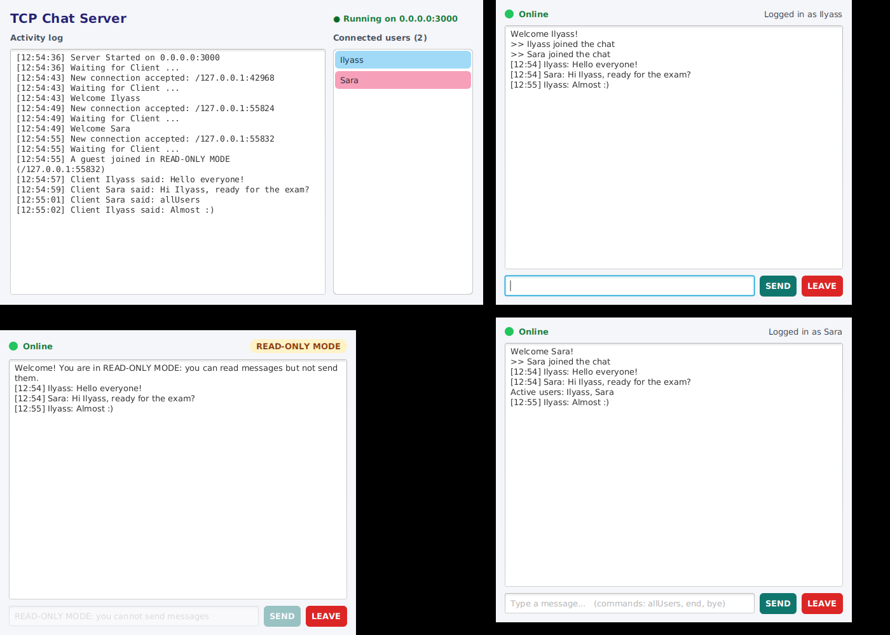
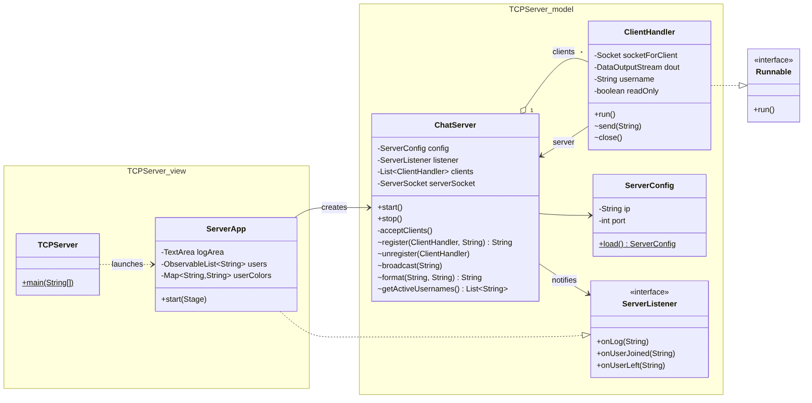
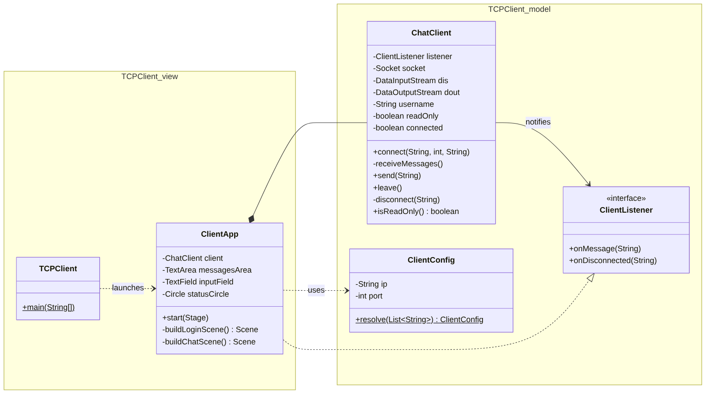
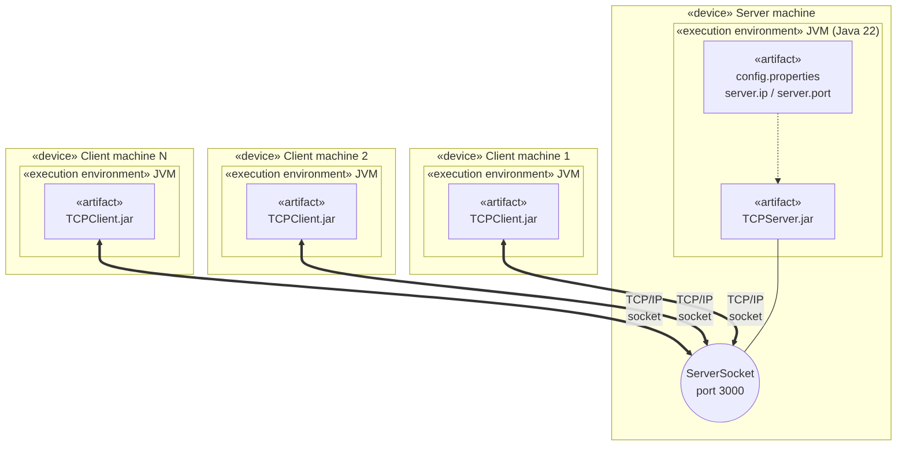
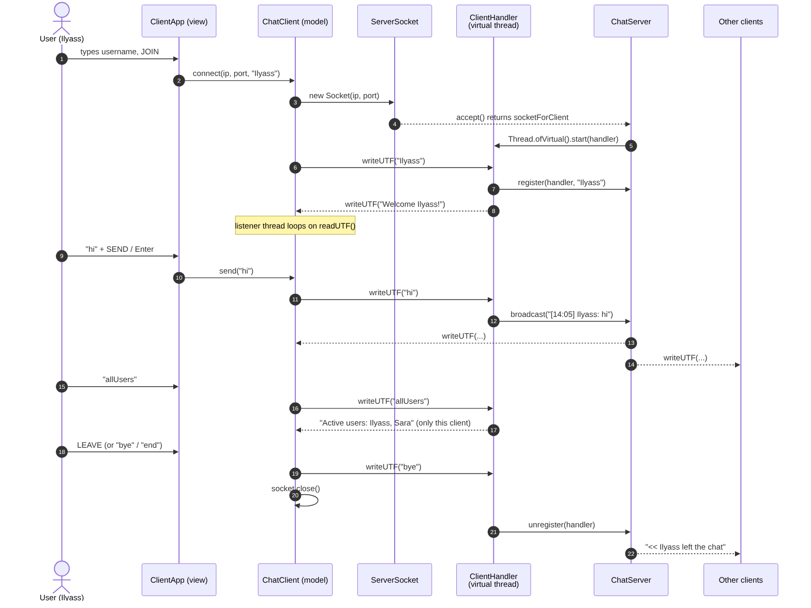

# Multi-Client Chat Application Using Java Sockets

Mini Project 1, **Paradigms of Programming: Part 1 (Client-Server Model and Programming)**
Prof. El Habib Nfaoui · Al Akhawayn University in Ifrane

**Author:** Ilyass Ourabine

A group chat built with **TCP sockets**, **virtual threads**, and **JavaFX**. One central server
receives each message from a client and distributes it to every connected client.



---

## Features

| Requirement | Where |
|---|---|
| Username before entering the chat | `ClientApp` login screen → first `writeUTF(username)` |
| **READ-ONLY MODE** when no username is given | `ChatClient.send()` + disabled input in `ClientApp`; double-checked by `ClientHandler` |
| Send with **SEND** button or **Enter** | `ClientApp.sendTypedMessage()` |
| `allUsers` → active users sent to *that* user only | `ClientHandler.run()` |
| Disconnect with `end`, `bye` or **LEAVE** | `ChatClient.send()` / `ChatClient.leave()` |
| "Online" label + colored circle indicator | `ClientApp` (green = online, red = offline) |
| Multiple concurrent clients, **one virtual thread per client** | `ChatServer.acceptClients()` → `Thread.ofVirtual().start(clientHandler)` |
| Messages formatted `[HH:mm] username: message` and broadcast | `ChatServer.format()` + `ChatServer.broadcast()` |
| Live `ListView` of connected users with **random background colors** | `ServerApp` |
| Activity log ("Server Started", "Waiting for Client", "Welcome [User]") | `ServerApp.onLog()` |
| IP and port loaded at runtime from `config.properties` | `ServerConfig`, `ClientConfig` |
| **Model-View decoupling** | `model` package has zero JavaFX imports (see below) |

---

## Architecture

```
IlyassOurabine_project1/
├── TCPServer/                       Maven project
│   └── src/main/
│       ├── java/ma/project/
│       │   ├── TCPServer.java          launcher (main)
│       │   ├── model/                  ← sockets, threads, chat logic (no JavaFX)
│       │   │   ├── ChatServer.java        accept loop, client list, broadcast
│       │   │   ├── ClientHandler.java     Runnable, one per client (virtual thread)
│       │   │   ├── ServerConfig.java      reads config.properties
│       │   │   └── ServerListener.java    interface: model → view events
│       │   └── view/
│       │       └── ServerApp.java         JavaFX UI (GridPane + CSS)
│       └── resources/  config.properties, server.css
├── TCPClient/                       Maven project
│   └── src/main/
│       ├── java/ma/project/
│       │   ├── TCPClient.java          launcher (main)
│       │   ├── model/
│       │   │   ├── ChatClient.java        socket, listener thread, send/leave
│       │   │   ├── ClientConfig.java      args → config.properties
│       │   │   └── ClientListener.java    interface: model → view events
│       │   └── view/
│       │       └── ClientApp.java         JavaFX UI (login + chat screens)
│       └── resources/  config.properties, client.css
└── docs/  uml/ (class, deployment, sequence diagrams), screenshots/
```

### Model-View decoupling

The **model** never imports JavaFX. It reports events through a small interface
(`ServerListener` / `ClientListener`), and the **view** implements that interface:

```
 ChatServer / ChatClient  ──calls──▶  ServerListener / ClientListener  ◀──implements──  ServerApp / ClientApp
        (model)                            (interface)                                       (view)
```

The view can be replaced (console, web, tests...) without touching the model.
The model was tested end-to-end with **no UI at all**, using console listeners.

### Communication protocol

TCP stream + `DataOutputStream.writeUTF()` / `DataInputStream.readUTF()`:

| Step | Client → Server | Server → Client(s) |
|---|---|---|
| 1. Join | `"Ilyass"` (first message = username, `""` = read-only) | `"Welcome Ilyass!"` to him, `">> Ilyass joined the chat"` to all |
| 2. Chat | `"hi"` | `"[14:05] Ilyass: hi"` to **all** |
| 3. Who's online | `"allUsers"` | `"Active users: Ilyass, Sara"` to **this client only** |
| 4. Leave | `"bye"` / `"end"` (or LEAVE button) | `"<< Ilyass left the chat"` to all |

### Concurrency

* **Server:** the main accept loop blocks on `serverSocket.accept()`. Each accepted socket is handed
  to a `ClientHandler` (`implements Runnable`) started with `Thread.ofVirtual().start(...)`.
  Virtual threads are cheap JVM-managed threads, so thousands of blocking `readUTF()` calls are fine.
* **Shared state:** the client list is a `CopyOnWriteArrayList` (safe to iterate while others join or leave);
  `ClientHandler.send()` is `synchronized` so two broadcasts never interleave on the same stream.
* **Client:** unlike a ping-pong console client, a chat must receive at any time. A dedicated
  listener thread loops on `readUTF()`, and the UI thread sends.
* **JavaFX thread rule:** network threads update the UI only through `Platform.runLater(...)`.

### UML

| Class diagram: server | Class diagram: client |
|---|---|
|  |  |

**Deployment diagram**



**Sequence diagram:** join → message → allUsers → leave



The Mermaid sources (`.mmd`) are next to each image in [`docs/uml`](docs/uml).

---

## Build and run

**Requirements:** JDK 22 and Maven (IntelliJ IDEA bundles Maven). JavaFX is downloaded by Maven.

```bash
# 1. build the executable JARs
cd TCPServer && mvn clean package && cd ..
cd TCPClient && mvn clean package && cd ..

# 2. start the server (reads config.properties)
java -jar TCPServer/target/TCPServer.jar

# 3. start as many clients as you want (one terminal each)
java -jar TCPClient/target/TCPClient.jar localhost 3000
```

The required syntax `java TCPClient <ServerIPAddress> <PortNumber>` with the class name:

```bash
java -cp TCPClient/target/TCPClient.jar ma.project.TCPClient localhost 3000
java -cp TCPServer/target/TCPServer.jar ma.project.TCPServer
```

From IntelliJ: open each folder as a Maven project, then run `mvn javafx:run`, or run the `main` of
`TCPServer` / `TCPClient`.

### Configuration (no recompilation needed)

`config.properties` is read at startup. Put an edited copy **next to where you run the JAR** to
override the default one packaged inside:

```properties
# TCPServer/config.properties
# 0.0.0.0 = all network interfaces, 127.0.0.1 = this machine only
server.ip=0.0.0.0
server.port=3000

# TCPClient/config.properties (used only when no command-line arguments are given)
server.ip=localhost
server.port=3000
```

To chat across machines on the same network, start clients with the server's LAN IP, for example
`java -jar TCPClient.jar 192.168.1.20 3000`.

---

## Concepts practiced

TCP sockets (`ServerSocket`, `Socket`) · blocking I/O streams (`DataInputStream`, `DataOutputStream`) ·
multithreading with **virtual threads** (Java 21+) · thread-safe shared state · client-server architecture ·
JavaFX (`GridPane`, `ListView`, CSS, `Platform.runLater`) · separation of concerns · runtime configuration.
